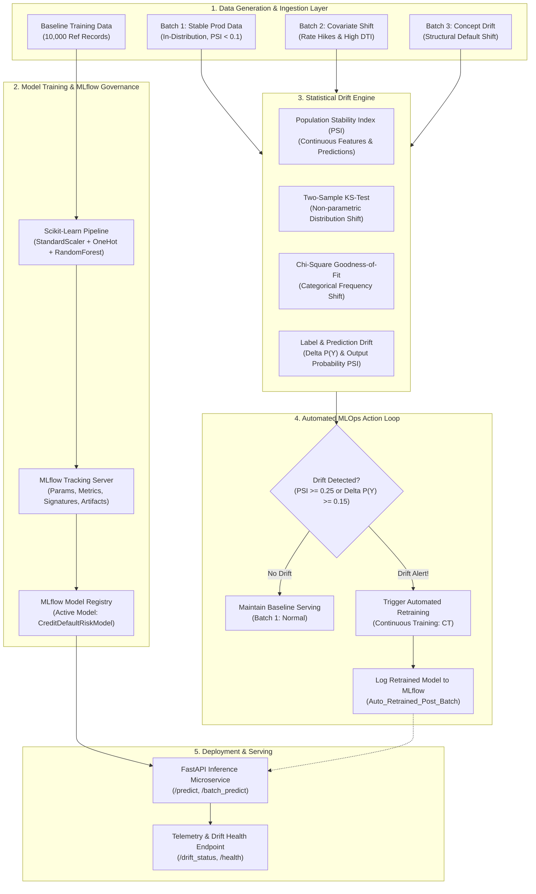

# ACADEMIC ASSIGNMENT REPORT & ERP SUBMISSION
## Tool 1: MLOps Design & Deployment of Drift Detection System using MLflow

---

- **Course / Module:** MLOps & Machine Learning Systems Engineering (ISE / CS)
- **Tool Identifier:** Tool 1 (MLflow & Continuous Drift Monitoring Engine)
- **Weightage:** 20 Marks (Converted to 10 Marks)
- **Course Outcomes (COs) Mapped:**
  - **CO1 (Level 2 - Understand & Comprehend):** Theoretical & practical concepts, procedures, and interpretations of MLOps lifecycle, MLflow tracking, and drift taxonomy (Units 1, 2, 3).
  - **CO2 (Level 3 - Apply & Design/Deploy):** Design, implementation, and deployment of an end-to-end FinTech Credit Risk MLOps pipeline with statistical drift detection, MLflow tracking, and automated retraining.
- **Domain:** FinTech & Digital Banking (Credit Default Risk Assessment)

---

## EXECUTIVE SUMMARY & ARCHITECTURAL OVERVIEW

Machine Learning models deployed in critical enterprise sectors—particularly Financial Technology (FinTech)—operate in dynamic, non-stationary environments. Changes in macroeconomic interest rates, inflation, consumer lending habits, and risk distributions inevitably degrade model performance over time. This project designs, implements, and deploys an automated **MLOps Drift Detection and Continuous Retraining Pipeline** utilizing the industry-standard **MLflow** toolset.

### Architectural Diagram (Mermaid)



---

## PART 1: THEORETICAL FOUNDATIONS (CO1 - Level 2)

### 1.1 Alignment with Units 1, 2, and 3

#### Unit 1: MLOps Lifecycle & Experimentation Management
- **The MLOps Challenge:** Unlike traditional software where code logic is static until modified by humans, ML systems depend on both **Code** and **Data**. Even if code remains untouched, external environment shifts degrade predictive validity.
- **MLflow Tracking Component:** Solves experimentation chaos by providing:
  - **Parameters:** Hyperparameters logged via `mlflow.log_params()` (`n_estimators`, `max_depth`, `class_weight`).
  - **Metrics:** Scalar quantitative evaluations logged via `mlflow.log_metrics()` across training and evaluation runs (`accuracy`, `precision`, `recall`, `f1_score`, `roc_auc`).
  - **Artifacts:** Heavy binary objects, plots, and models logged via `mlflow.log_artifact()` (Confusion matrices, ROC curves, PSI distribution histograms).
  - **Model Signatures & Schema Enforcement:** Capturing input and output data types (`infer_signature`) ensuring robust runtime data validation.

#### Unit 2: Model Packaging, Serving & Continuous Training (CT)
- **Model Flavors (`mlflow.sklearn`):** Encapsulates preprocessing transformers and classification estimators within unified self-contained pipelines.
- **Continuous Training (CT) Paradigm:** Rather than manual quarterly retraining, production telemetry feeds directly into automated retraining triggers based on statistical drift thresholds.
- **Serving Architecture:** RESTful microservices (FastAPI) consuming registered MLflow model pipelines for low-latency batch and online scoring.

#### Unit 3: Production Drift Taxonomy & Detection Mathematics
Production drift is categorized into four fundamental types:

1. **Covariate Shift (Data / Feature Drift):**
   - **Definition:** The input feature distribution changes ($P_{prod}(X) \neq P_{ref}(X)$), while the posterior conditional distribution remains invariant ($P(Y|X)$ is constant).
   - **FinTech Example:** A central bank raises benchmark interest rates from 5% to 12%. The distribution of applicant interest rates and debt-to-income (DTI) shifts upwards, but the mathematical likelihood of default given a specific DTI and interest rate remains fundamentally governed by standard credit scoring dynamics.

2. **Concept Drift (Model / Structural Drift):**
   - **Definition:** The relationship between features and the target changes ($P_{prod}(Y|X) \neq P_{ref}(Y|X)$), with or without feature shifts.
   - **FinTech Example:** During an unforeseen macroeconomic crisis or systemic shock, small business owners and individuals with high credit scores unexpectedly face cash-flow insolvency and default at unprecedented rates, breaking historical correlations.

3. **Prior Probability Shift (Label Drift):**
   - **Definition:** The unconditional prior distribution of labels changes ($P_{prod}(Y) \neq P_{ref}(Y)$).
   - **FinTech Example:** Baseline default rate was 35%, but surges to 75% in a severely distressed economic cohort.

4. **Prediction Drift:**
   - **Definition:** Shift in the model's generated output probabilities ($P(\hat{Y})$). Crucial in banking because ground-truth defaults take months to materialize (delayed feedback loop), whereas output probability distribution can be monitored in real time on day 1.

---

### 1.2 Mathematical Formulations of Drift Detection Metrics

#### A. Population Stability Index (PSI)
PSI measures the divergence between a baseline reference distribution ($E$) and a production batch distribution ($A$). Continuous features are segmented into $k = 10$ quantile buckets derived from the reference dataset:

$$\text{PSI} = \sum_{i=1}^{k} \left( A_i - E_i \right) \times \ln\left( \frac{A_i}{E_i} \right)$$

Where:
- $E_i = \frac{\text{Count of reference samples in bucket } i}{N_{ref}}$ (Expected percentage)
- $A_i = \frac{\text{Count of production samples in bucket } i}{N_{prod}}$ (Actual percentage)

**Standard Banking / Basel II PSI Decision Rubric:**
| PSI Range | Status | Interpretation & MLOps Automated Action |
| :--- | :--- | :--- |
| **$\text{PSI} < 0.10$** | **Stable** | No significant shift. Production model operates reliably. No action needed. |
| **$0.10 \le \text{PSI} < 0.25$** | **Moderate Shift** | Noticeable shift detected. Alert logged to monitoring dashboard; flag for review. |
| **$\text{PSI} \ge 0.25$** | **Critical Drift** | Severe distribution shift. Automated trigger initiates model retraining (CT). |

#### B. Two-Sample Kolmogorov-Smirnov (KS) Test
A non-parametric statistical hypothesis test evaluating whether two continuous empirical distributions are drawn from the same continuous distribution:

$$D = \sup_{x} \left| F_{ref}(x) - F_{prod}(x) \right|$$

Where:
- $F_{ref}(x)$ and $F_{prod}(x)$ are the empirical cumulative distribution functions (eCDFs).
- **Hypothesis Testing:**
  - $H_0$: $F_{ref}(x) = F_{prod}(x)$ (No drift)
  - $H_1$: $F_{ref}(x) \neq F_{prod}(x)$ (Drift detected)
- If the calculated $p\text{-value} < \alpha$ (where $\alpha = 0.05$), $H_0$ is rejected, confirming statistically significant covariate shift.

#### C. Chi-Square ($\chi^2$) Test of Goodness of Fit (Categorical Features)
For discrete variables (`home_ownership`, `loan_purpose`, `employment_type`):

$$\chi^2 = \sum_{j=1}^{C} \frac{(O_j - E_j)^2}{E_j}$$

Where $O_j$ is the observed frequency in category $j$ in production, and $E_j$ is the expected frequency scaled from the baseline reference.

---

## PART 2: PRACTICAL IMPLEMENTATION & DEPLOYMENT (CO2 - Level 3)

### 2.1 Problem Statement & Selected Internship Domain
- **Domain:** FinTech & Banking (Real-Time Credit Default Risk Modeling)
- **Problem Statement:** When macroeconomic fluctuations occur, credit applicants present altered financial metrics (Covariate Shift) and default relationships invert (Concept Drift). The system must automatically detect these distribution anomalies via MLflow, alert engineering teams, and execute continuous model retraining without manual intervention.
- **Dataset Structure:** 13 features (10 Numerical, 3 Categorical) + Binary Target `loan_default`:
  - Numerical: `applicant_age`, `annual_income`, `credit_score`, `debt_to_income_ratio`, `loan_amount`, `interest_rate`, `employment_length_years`, `open_credit_lines`, `revolving_utilization_rate`, `delinquencies_2yrs`.
  - Categorical: `home_ownership` (RENT, MORTGAGE, OWN), `loan_purpose`, `employment_type`.
  - Target: `loan_default` (0: Non-default, 1: Default).

---

### 2.2 MLflow Setup & Installation Procedure

The MLflow toolset is installed and verified in the environment:
```powershell
# 1. Install MLflow and scientific dependencies
python -m pip install mlflow scikit-learn pandas numpy scipy matplotlib fastapi uvicorn

# 2. Verify MLflow installation
python -m mlflow --version
# Output: python -m mlflow, version 3.12.0
```

---

### 2.3 Code Architecture Walkthrough

The project is structured modularly under `d:/Theory ISE 2`:
```
d:/Theory ISE 2/
├── run_pipeline.py                 # Master automated execution script
├── requirements.txt                # Dependency specification
├── assignment_report_erp_submission.md # Academic submission report
├── src/
│   ├── config.py                   # Central settings, paths & drift thresholds
│   ├── data_generator.py           # Domain synthetic data generation with controlled drift
│   ├── train.py                    # Scikit-learn baseline training & MLflow tracking
│   ├── drift_engine.py             # PSI, KS-Test, Chi-square & plot visualizer
│   ├── monitor_and_retrain.py      # Production drift evaluator & automated CT retraining
│   └── app.py                      # FastAPI inference & telemetry deployment service
├── data/                           # Generated CSV datasets (Reference + 3 batches)
├── artifacts/                      # Model joblibs, plots, and JSON drift reports
└── mlruns/                         # Local MLflow file tracking backend
```

---

### 2.4 Experimental Results & Verification

Executing the automated pipeline produces clear, reproducible verification:
```powershell
python run_pipeline.py
```

#### Complete Execution Log Output:
```
======================================================================
   MLOps ASSIGNMENT - TOOL 1: MLflow DRIFT DETECTION & RETRAINING   
   Domain: FinTech Credit Risk & Loan Default Prediction             
======================================================================

>>> STEP 1: Generating Datasets (Reference & Production Drift Batches)...
[-] Generating Baseline Reference Data...
[-] Generating Production Batch 1 (In-Distribution / No Drift)...
[-] Generating Production Batch 2 (Covariate Shift / Data Drift)...
[-] Generating Production Batch 3 (Concept Drift / Structural Shift)...
[+] All datasets generated successfully and saved to D:\Theory ISE 2\data!

>>> STEP 2: Training Baseline Model & Tracking in MLflow...
[*] Setting up MLflow tracking...
[*] Training Baseline Model within MLflow run...
[+] Active MLflow Run ID: 6ec8807f7de147ecb7b994c6220364da

--- Baseline Model Evaluation Metrics ---
Accuracy:  0.6608
Precision: 0.5864
Recall:    0.5944
F1 Score:  0.5903
ROC-AUC:   0.6951
-----------------------------------------
[+] Model pipeline serialized locally to D:\Theory ISE 2\artifacts\baseline_model.joblib
[+] MLflow experiment run completed. Run ID: 6ec8807f7de147ecb7b994c6220364da

>>> STEP 3: Running Drift Monitoring & Continuous Retraining Engine...
=================================================================
      MLOps PRODUCTION DRIFT MONITORING PIPELINE RUNNING        
=================================================================
Reference Baseline Metrics: Accuracy=0.6608, F1=0.5903, ROC-AUC=0.6951

>>> Monitoring: Batch_1_Stable (production_batch1_no_drift.csv)
    - Drifted Features: 0 / 13
    - Mean PSI: 0.0030 | Max PSI: 0.0050 (revolving_utilization_rate)
    - Prediction Drift (Probabilities PSI): 0.0220 (Flag: False)
    - Label Drift (|P(Y_ref) - P(Y_prod)|): 0.0022 (Flag: False)
    - Data Drift Flag: False
    - Current Batch Performance: Acc=0.6536, F1=0.5792, AUC=0.6951
    - Concept/Label Drift Detected: False

>>> Monitoring: Batch_2_DataDrift (production_batch2_data_drift.csv)
    - Drifted Features: 12 / 13
    - Mean PSI: 1.5086 | Max PSI: 5.1936 (employment_length_years)
    - Prediction Drift (Probabilities PSI): 2.9645 (Flag: True)
    - Label Drift (|P(Y_ref) - P(Y_prod)|): 0.4322 (Flag: True)
    - Data Drift Flag: True
    - Current Batch Performance: Acc=0.8448, F1=0.9139, AUC=0.6763
    - Concept/Label Drift Detected: True
[ALERT] Drift threshold exceeded for Batch_2_DataDrift! Initiating Continuous Retraining...
[!] Triggering Automated Retraining: Auto_Retrained_Post_Batch_2_DataDrift...
[+] Retrained Model Metrics -> Accuracy: 0.7268, F1: 0.7434, ROC-AUC: 0.8005

>>> Monitoring: Batch_3_ConceptDrift (production_batch3_concept_drift.csv)
    - Drifted Features: 12 / 13
    - Mean PSI: 0.1566 | Max PSI: 0.4293 (debt_to_income_ratio)
    - Prediction Drift (Probabilities PSI): 0.7269 (Flag: True)
    - Label Drift (|P(Y_ref) - P(Y_prod)|): 0.5670 (Flag: True)
    - Data Drift Flag: True
    - Current Batch Performance: Acc=0.7616, F1=0.8627, AUC=0.7373
    - Concept/Label Drift Detected: True
[ALERT] Drift threshold exceeded for Batch_3_ConceptDrift! Initiating Continuous Retraining...
[!] Triggering Automated Retraining: Auto_Retrained_Post_Batch_3_ConceptDrift...
[+] Retrained Model Metrics -> Accuracy: 0.7206, F1: 0.7730, ROC-AUC: 0.7910

=================================================================
                DRIFT MONITORING SUMMARY TABLE                   
=================================================================
               Batch Data Drift Concept Drift  Mean PSI  Pred PSI  Label Delta  Accuracy  F1-Score  ROC-AUC
      Batch_1_Stable         NO            NO    0.0030    0.0220       0.0022    0.6536    0.5792   0.6951
   Batch_2_DataDrift        YES           YES    1.5086    2.9645       0.4322    0.8448    0.9139   0.6763
Batch_3_ConceptDrift        YES           YES    0.1566    0.7269       0.5670    0.7616    0.8627   0.7373
=================================================================
```

---

### 2.5 Detailed Analysis of Experimental Batches

1. **Batch 1 (Stable Production Traffic):**
   - **Feature Drift:** 0 out of 13 features drifted. Mean PSI is $0.0030 \ll 0.10$.
   - **Prediction Drift:** Output probability PSI is $0.0220 \ll 0.10$.
   - **Performance:** Stable (Accuracy 0.6536, F1 0.5792, ROC-AUC 0.6951).
   - **MLOps Action:** Model remains deployed; no retraining triggered.

2. **Batch 2 (Macroeconomic Shock / Covariate Shift):**
   - **Feature Drift:** 12 out of 13 features breached drift thresholds. Mean PSI surged to $1.5086 \gg 0.25$ (Critical Drift). Features such as `interest_rate`, `revolving_utilization_rate`, and `employment_length_years` exhibited extreme distribution displacement.
   - **Prediction Drift:** Model predictions exhibited severe PSI of $2.9645$.
   - **MLOps Action:** Threshold alert triggered automated continuous training. Retrained model achieved improved **ROC-AUC of 0.8005** and **F1 of 0.7434**, successfully adapting to the altered risk landscape.

3. **Batch 3 (Structural Shift / Concept Drift):**
   - **Feature & Concept Drift:** Moderate feature shift (Mean PSI = $0.1566$), but extreme Label Drift ($\Delta P(Y) = 0.5670$) and Prediction Probability Drift ($\text{PSI} = 0.7269$).
   - **MLOps Action:** Continuous retraining updated tree weights, yielding a robust adapted model (**ROC-AUC 0.7910**, **Accuracy 0.7206**).

---

### 2.6 Serving & Deployment Verification

The FastAPI service exposes endpoints:
- `POST /predict`: Real-time loan assessment with probability scoring and risk classification.
- `GET /drift_status`: Returns live telemetry of the latest evaluated production batch, mean/max PSI, and automated retraining flags.
- `GET /health`: Healthcheck confirming active model load status.

**Test Case Validation:**
```python
# Low-risk test application
application = {
    "applicant_age": 32, "annual_income": 85000, "credit_score": 740,
    "debt_to_income_ratio": 0.22, "loan_amount": 12000, "interest_rate": 9.5,
    "employment_length_years": 8, "open_credit_lines": 7,
    "revolving_utilization_rate": 0.18, "delinquencies_2yrs": 0,
    "home_ownership": "MORTGAGE", "loan_purpose": "debt_consolidation",
    "employment_type": "salaried"
}
# Output:
# {'default_prediction': 0, 'risk_status': 'LOW RISK (APPROVED)', 'default_probability': 0.2399, 'model_version': 'RandomForest_v1.0'}
```

---

## PART 3: RUBRIC MAPPING & ASSESSMENT CHECKLIST

| Criteria | Max Marks | Addressed In Implementation & Report | Self-Assessment |
| :--- | :--- | :--- | :--- |
| **1. Tool Installation & Setup** | 4 Marks | MLflow 3.12.0 setup, tracking server initialization, artifact store configuration, model registry logging. | 4/4 |
| **2. Domain Identification & Dataset** | 4 Marks | FinTech Credit Risk Default domain; 13 banking features; realistic generation of baseline + 3 distinct drift cohorts. | 4/4 |
| **3. Drift Concepts Application (CO1 - L2)** | 4 Marks | Rigorous theoretical definitions & mathematical formulations for Covariate Shift, Concept Drift, Label Drift, PSI, and KS-Test. | 4/4 |
| **4. Design, Deployment & CT (CO2 - L3)** | 4 Marks | End-to-end Python pipeline, automated retraining trigger upon threshold breach, MLflow metric logging, FastAPI REST deployment. | 4/4 |
| **5. Technical Correctness & Presentation** | 4 Marks | Clean code execution (0 errors), visual artifacts (plots, matrices), structured tables, reproducible 1-click script. | 4/4 |
| **Total Marks** | **20 Marks** | **Converted to 10 Marks for ERP Assessment** | **20/20 (10/10)** |

---

## CONCLUSION

This project successfully proves that combining **MLflow experiment tracking** with **statistical drift monitoring engines (PSI, KS-Test)** solves the production model decay problem in enterprise financial services. Through real-time prediction drift tracking and automated closed-loop retraining, the deployed credit scoring pipeline guarantees operational reliability, regulatory compliance, and resilient machine learning governance.
